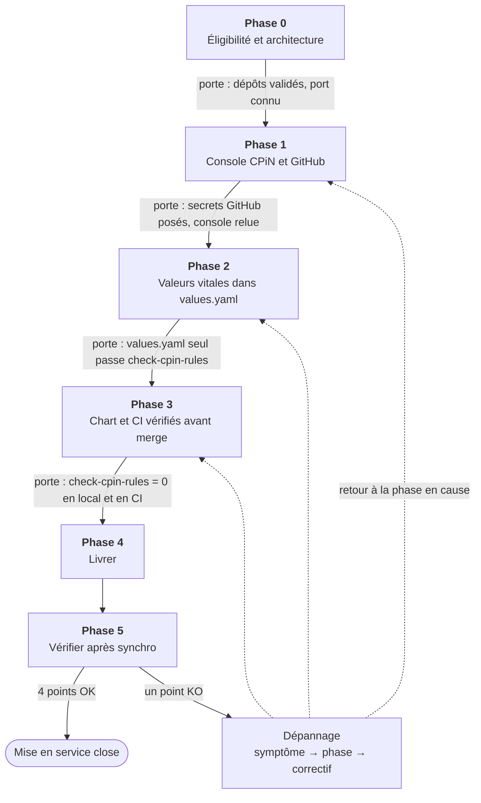
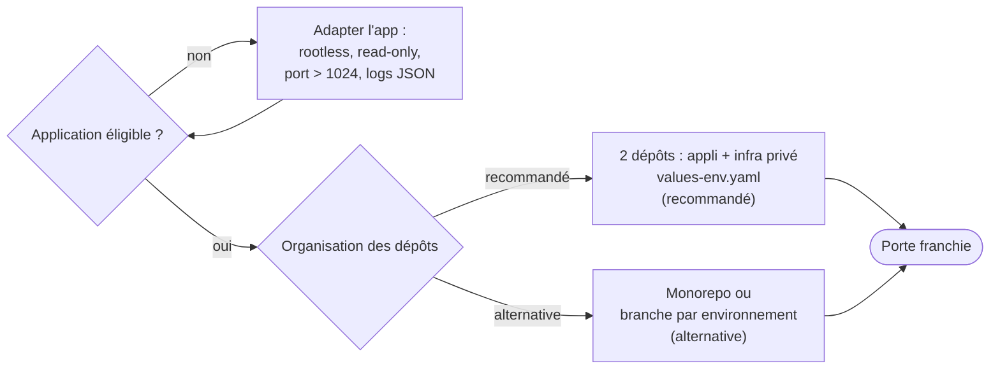
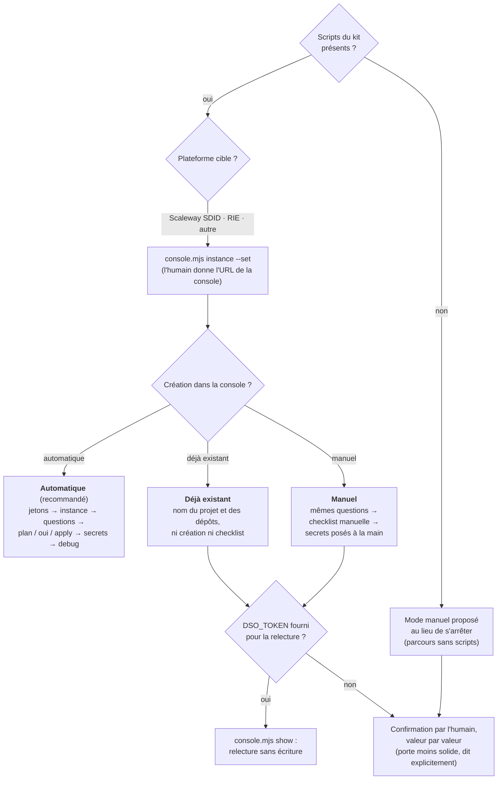
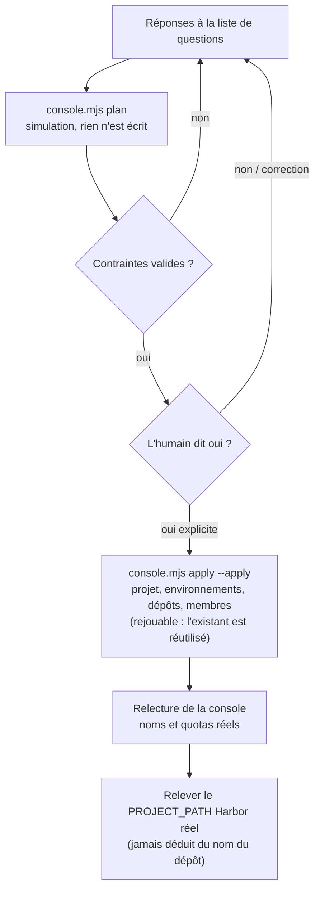
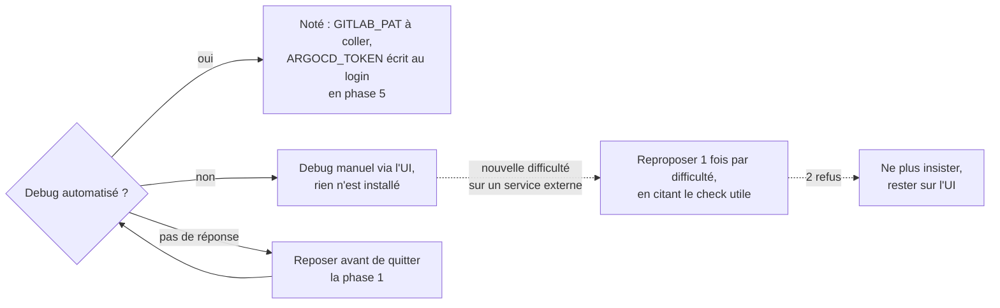
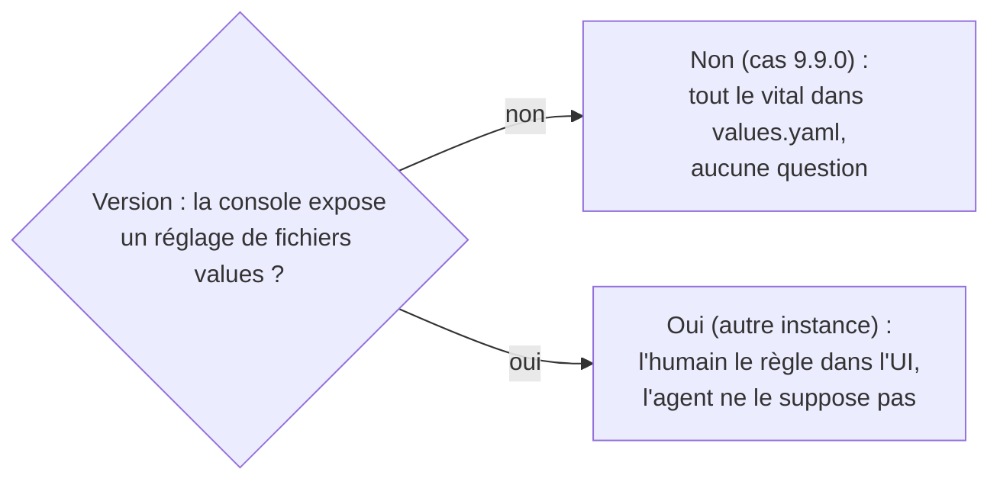
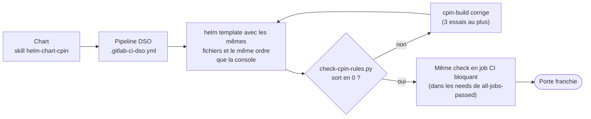
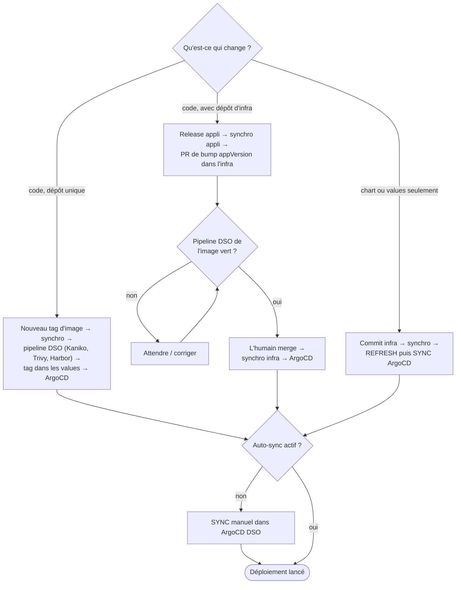
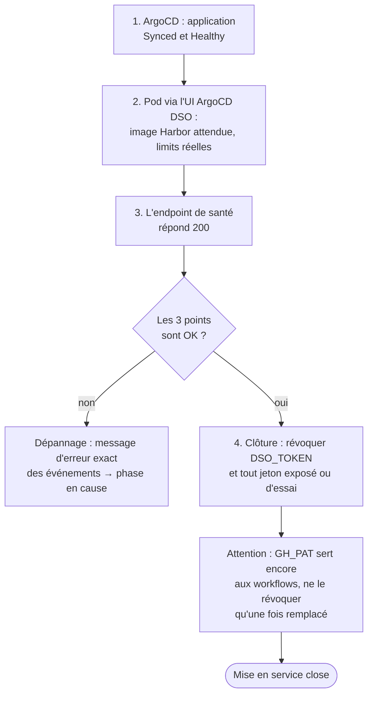
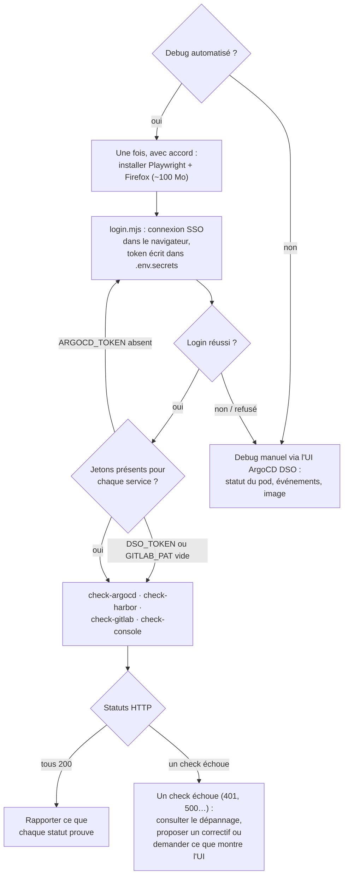

# Déploiement sur Cloud Pi Native : le flow en schémas

Vue simplifiée du runbook suivi par le skill [`deploiement-cpin`](../.agents/skills/dso/deploiement-cpin/SKILL.md)
(groupe `dso`) et par l'agent `cpin-orchestrateur` (`/deployer-cpin`). Le détail des étapes, des commandes et du
dépannage reste dans le `SKILL.md` : ce document ne fait que montrer **l'enchaînement des phases et les
ramifications selon les réponses**.

> **Principe : vérifier avant le merge, pas au déploiement.** Chaque aller-retour « je déploie, je regarde, je
> corrige » coûte une release (vécu : 7 releases pour un hello world). Chaque phase se termine par une
> **porte** : on ne passe pas à la suivante tant qu'elle n'est pas franchie.

## Vue d'ensemble

| Phase | Qui | Porte (condition pour passer à la suite) |
|-------|-----|------------------------------------------|
| 0 Éligibilité | vous | organisation des dépôts validée, port réellement écouté connu |
| 1 Console et GitHub | vous | secrets et variables GitHub posés, console relue ou confirmée valeur par valeur |
| 2 `values.yaml` | vous | le rendu de `values.yaml` seul passe `check-cpin-rules.py` |
| 3 Chart et CI | agents (`cpin-plan` → `cpin-build` → `cpin-review`) | `check-cpin-rules.py` sort en 0, en local **et** en CI |
| 4 Livrer | vous | déploiement lancé |
| 5 Vérifier | vous | ArgoCD `Synced` + `Healthy`, bonne image, endpoint de santé en 200, jetons révoqués |

## Phase 0 : éligibilité et architecture

L'application doit être Linux, **stateless**, configurée par variables d'environnement, **rootless**, en système
de fichiers **lecture seule**, écouter sur un port > 1024 et loguer en JSON sur stdout.

## Phase 1 : console CPiN et GitHub

### Deux questions d'ouverture, avant tout jeton

Elles décident quel `DSO_TOKEN` créer, et s'il en faut un.

### Mode automatique : simuler, confirmer, appliquer

L'agent pose toutes les questions **en une seule liste** (nom du projet, environnements, quotas, dépôts,
membres, debug automatisé), puis ne passe à l'écriture qu'après un « oui » explicite.

### Debug automatisé : toujours proposé

## Phase 2 : valeurs vitales dans `values.yaml`

Sur une console 9.9.0, le dépôt n'a **aucun réglage de fichiers values** : seul `values.yaml` est garanti chargé.
Il porte donc toutes les valeurs vitales (image Harbor, `registry-pull-secret`, ressources sous le quota,
labels, port, ingress avec son host réel). `values-<env>.yaml` n'est qu'un complément dont l'effet se constate
en phase 5.

## Phase 3 : chart et CI, vérifiés avant le merge

## Phase 4 : livrer

Un tag d'image inchangé ne produit aucun diff pour ArgoCD, donc aucun redéploiement.

## Phase 5 : vérifier après la synchro

### Debug automatisé en phase 5

Les checks ne renvoient que des **statuts HTTP** : ils éliminent une cause (jeton expiré, service injoignable),
ils ne disent pas pourquoi un pod échoue.

| Symptôme | Check | Ce que dit le statut |
|----------|-------|----------------------|
| Synchro qui échoue, dépôt absent du GitLab interne | `check-gitlab` | 200 : GitLab joignable, `GITLAB_PAT` valide ; 401 : jeton refusé |
| `ImagePullBackOff`, 401 au pull, image introuvable | `check-harbor` | 200 : Harbor joignable ; 401/403 : session SSO expirée |
| Application absente ou `OutOfSync` | `check-argocd` | 200 : API ArgoCD répond ; 401 : session SSO expirée |
| Projet, environnement ou dépôt non créé, quota | `check-console` | 200 : `DSO_TOKEN` valide ; 401 : expiré ou révoqué |

## Règles de l'agent, tout au long du runbook

- **Suivi visible** : une todo par phase, une seule « en cours », chaque message commence par
  `▶ Phase N/5 — <nom> · étape : <étape>`.
- **Jamais de valeur de secret** : l'humain colle les jetons dans `.cpin/.env.secrets`, l'agent vérifie seulement
  « renseigné » / « vide ».
- **La console CPiN est la source de vérité** : rien ne se modifie à la main dans l'UI ArgoCD ou le GitLab interne.
- **Pas de CLI de cluster** (`oc`, `kubectl`) : l'état réel se lit dans l'UI ArgoCD DSO ou la console.
- **Toute écriture dans la console** se fait après un « oui » explicite.
- **Les instances diffèrent** : relever la version réelle (`/api/v1/version`) avant de supposer un comportement ;
  une URL de service inconnue se relève, elle ne se déduit pas d'une autre instance.
